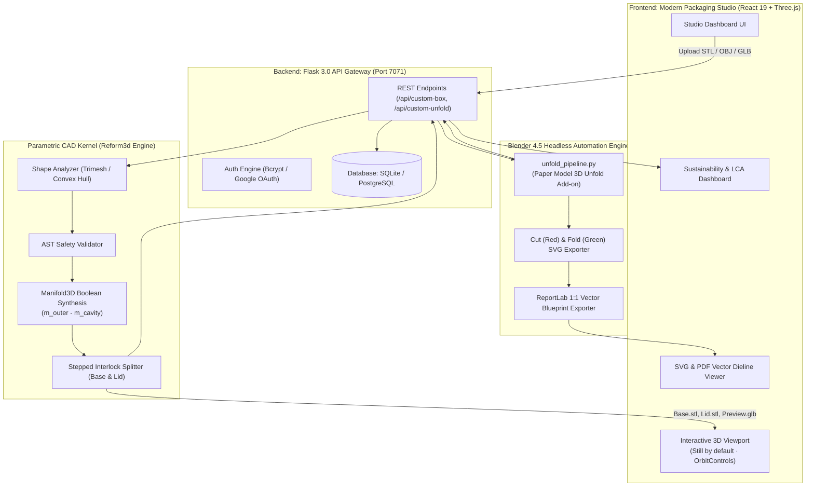

# 📦 MorphoPack: AI-Powered Autonomous Packaging Engineering & Sustainability Platform

[](LICENSE)
[](https://python.org)
[](https://react.dev)
[](https://threejs.org)
[](https://blender.org)
[](https://github.com/elalish/manifold)

> **MorphoPack** is an end-to-end intelligent packaging engineering studio that transforms arbitrary 3D product meshes into **zero-void, form-fitting packaging enclosures and production dielines**. By combining high-speed boolean CAD kernels (`manifold3d`), automated 3D mesh unfolding (Blender 4.5), and parametric code generation, MorphoPack eliminates up to **86% of shipping air void**, minimizes filler waste, and provides real-time lifecycle carbon and recyclability analytics.

---

## 📑 Table of Contents
- [Problem Statement](#-problem-statement)
- [The MorphoPack Solution](#-the-morphopack-solution)
- [System Architecture](#-system-architecture)
- [Core Features & Engineering](#-core-features--engineering)
- [Sustainability & Analytics Engine](#-sustainability--analytics-engine)
- [Tech Stack](#-tech-stack)
- [Repository Structure](#-repository-structure)
- [Getting Started](#-getting-started)
- [API Reference](#-api-reference)
- [Roadmap & Contributing](#-roadmap--contributing)

---

## 🎯 Problem Statement

Every year, global logistics transports billions of tons of cargo inside standard rectangular boxes. This legacy approach suffers from severe inefficiencies:

1. **Massive Void Space ("Shipping Air")**:
   Standardized cuboid boxes rarely match the organic silhouettes of products (tumblers, hardware, electronics, figurines, tools). Over **24% to 40%** of average parcel volume is empty air.
2. **Excessive Cushioning & Single-Use Fillers**:
   To prevent product movement inside oversized boxes, manufacturers consume tons of non-biodegradable void fillers—plastic air pillows, bubble wraps, and EPS foam peanuts.
3. **Escalated Transportation Footprint & Costs**:
   Volumetric weight billing ($DIM$) and bloated freight sizes lead to under-utilized shipping containers, higher fuel consumption, and millions of metric tons of avoidable lifecycle $\text{CO}_2$ emissions.
4. **Slow, High-Cost Packaging Prototyping**:
   Engineering custom packaging previously demanded manual industrial CAD drafting, expensive mold tooling, and days of physical fold iterations.

---

## 💡 The MorphoPack Solution

MorphoPack automates the packaging pipeline from uploaded 3D product mesh to production files in seconds:

* **3D Product Mesh Shape Identification**: Automatically detects dimensions, volume, 2D footprints, and form-factor topology (rotational, prismatic, or organic contoured).
* **Form-Fitting CAD Box Packaging (Base & Lid)**: Powered by `manifold3d` and the Reform3d CAD engine, synthesizing watertight, non-cuboid hollow 3D enclosures with stepped slip-fit interlocks tailored to the product's exact contours.
* **Blender 4.5 Automated 3D Mesh Unfolding**: Flattens 3D shapes into clean 2D dieline patterns (SVG cut & crease vectors and manufacturing-ready 1:1 scale PDFs).
* **Quantitative Sustainability Benchmarking**: Directly compares the custom-fitted enclosure against the standard cuboid package, quantifying void volume reduction, material savings, avoided carbon emissions, and recyclability scores.

---

## 🏗️ System Architecture



---

## ⚡ Core Features & Engineering

### 1. Shape-Conforming 3D CAD Packaging Box (Base & Lid)
Instead of forcing products into primitive cylinders or boxes, the CAD kernel constructs a true 3D shape envelope:
- **Inner Cavity Cushion**:
  $$\text{Scale}_{\text{cavity}} = \left[ \frac{L + 2c}{L},\, \frac{W + 2c}{W},\, \frac{H + 2c}{H} \right]$$
  where $c$ is the specified clearance cushion ($1.0\text{ mm} - 6.0\text{ mm}$).
- **Outer Protective Shell**:
  $$\text{Scale}_{\text{outer}} = \left[ \frac{L + 2(c + w)}{L},\, \frac{W + 2(c + w)}{W},\, \frac{H + 2(c + w)}{H} \right]$$
  where $w$ is the shell wall thickness ($1.5\text{ mm} - 5.0\text{ mm}$).
- **Hollow Enclosure**:
  $$M_{\text{box}} = M_{\text{outer}} \setminus M_{\text{cavity}}$$
- **Stepped Slip-Fit Interlock**: The box is split at a customizable ratio ($Z_{\text{split}}$) into a **Base** with an extruded stepped lip and a **Lid** with a recessed pocket incorporating slip tolerance ($0.35\text{ mm}$).
- **Downloadable Deliverables**:
  - `custom_box_base.stl`
  - `custom_box_lid.stl`
  - `custom_box_assembled.stl`
  - `custom_box_preview.glb` (Base rendered in `#16A34A`, Lid in `#3B82F6`)

### 2. Blender Headless 3D Mesh Unfolding
- Interfaces headlessly with **Blender 4.5 LTS** via background command-line execution (`blender --background --python unfold_pipeline.py`).
- Imports the target 3D model, runs topological decimation (up to 1,000 faces) for optimal score-to-fold manufacturing ratios, unfolds the mesh onto a 2D plane with zero edge overlaps, and adds assembly tabs.
- Outputs production SVGs color-coded according to packaging standards:
  - **Solid Red (`#DC2626`)**: Cut lines
  - **Dashed Blue (`#2563EB`)**: Valley folds
  - **Dotted Green (`#16A34A`)**: Mountain folds

### 3. Interactive WebGL 3D Studio Viewport
- Built with **Three.js** (`r187`).
- **Grounded & Centered**: Automatically normalizes uploaded model coordinate offsets, placing the base flush with the grid floor ($Y = 0$) with zero floating or axis wobble.
- **Still by Default with Manual Controls**: Begins completely still (no involuntary spinning); users can manually rotate, pan, and zoom via `OrbitControls`.
- Multi-mode preview selector: toggle between **Both Parts**, **Base Only**, and **Lid Only**.

---

## 📊 Sustainability & Analytics Engine

Every run produces automated Lifecycle Assessment (LCA) telemetry:

### 1. Void Volume Reduction
$$\Delta V_{\text{void}} = \frac{V_{\text{cuboid}} - V_{\text{fitted}}}{V_{\text{cuboid}}} \times 100\%$$
Quantifies the reduction in air void volume achieved by conforming to the product's 3D silhouette rather than using an oversized rectangular box.

### 2. Avoided Carbon Emissions ($\text{CO}_2\text{e}$)
$$\text{CO}_{2,\text{saved}} = \Delta M_{\text{material}} \times \text{EF}_{\text{material}} + \Delta V_{\text{freight}} \times \text{EF}_{\text{freight}}$$
- $\text{EF}_{\text{material}}$: Emission factors derived from packaging LCA databases (e.g., $0.94\text{ kg CO}_2/\text{kg}$ for corrugated board; $2.10\text{ kg CO}_2/\text{kg}$ for virgin PLA).
- Tracks degradation timelines, material recyclability percentages, and sheet cutting efficiency.

### 3. Supported Material Profiles
| Material Profile | Density ($\text{g/cm}^3$) | Recyclability | Typical Biodegradation |
| :--- | :---: | :---: | :---: |
| **Corrugated Cardboard** | 0.65 | 87% | 2 – 4 months |
| **Kraft Paperboard** | 0.80 | 92% | 1 – 3 months |
| **Recycled PLA (3D Print)** | 1.24 | 75% | 12 – 24 months (Industrial) |
| **Moulded Pulp Fiber** | 0.55 | 95% | 1 – 2 months |
| **Mycelium Bio-Composite** | 0.30 | 100% | 1 – 2 months (Home compost) |

---

## 🛠️ Tech Stack

### Frontend
- **Framework**: React 19.0 with Vite 5
- **3D Graphics**: Three.js (`r187`), `STLLoader`, `GLTFLoader`, `OBJLoader`, `OrbitControls`
- **Charts & Telemetry**: Chart.js 4.4, `react-chartjs-2`
- **Icons & Styling**: Lucide React, Modular CSS3 Packaging Studio Design System
- **Authentication**: `@react-oauth/google`

### Backend & API
- **Framework**: Python 3.11+, Flask 3.0, Flask-CORS
- **Database**: SQLite (default) / PostgreSQL via SQLAlchemy 2.0 ORM
- **Security**: Bcrypt password hashing, session tokens, Google OAuth2 verify
- **Documentation & PDF**: ReportLab 4.0, `svglib`

### CAD & Computational Geometry
- **CSG Kernel**: `manifold3d` 3.5+ (Guaranteed watertight manifold Booleans)
- **Mesh Processing**: `trimesh` 4.0+, `scipy.spatial` (ConvexHull), `shapely` 2.0+
- **Numerical Processing**: `numpy` 1.24+

### Unfolding Automation
- **Blender**: Blender 4.5 LTS (Headless CLI mode)
- **Add-on / Library**: Blender Python API (`bpy`) with Paper Model export

---

## 📁 Repository Structure

```
MorphoPack-Packaging/
├── backend/                         # Flask API & CAD Kernel Backend
│   ├── cad_box_kernel.py           # Reform3d manifold3d box generator & AST validator
│   ├── morpho_pipeline.py          # Sustainability calculation & LCA algorithms
│   ├── requirements.txt            # Python dependencies
│   └── server.py                   # REST API routes & database operations
├── frontend/                        # React 19 + Vite Frontend Studio
│   ├── public/models/              # Sample 3D test meshes (e.g., glass.stl)
│   ├── src/
│   │   ├── components/
│   │   │   ├── CustomBoxPanel.jsx     # Form-fitting CAD Base/Lid packaging studio
│   │   │   ├── CustomUnfoldPanel.jsx  # Headless Blender unfolding & dieline viewer
│   │   │   ├── DieleineViewer.jsx     # Vector SVG / PDF dieline inspection
│   │   │   ├── HistoryPanel.jsx       # Historical runs & packaging benchmarks
│   │   │   ├── SheetNestingPanel.jsx  # Industrial sheet cutting & nesting analysis
│   │   │   └── SustainabilityDash.jsx # Environmental carbon & void reduction metrics
│   │   ├── pages/
│   │   │   ├── DashboardPage.jsx      # Main application studio
│   │   │   └── LoginPage.jsx          # User authentication & Google Sign-In
│   │   └── utils/
│   │       ├── api.js                 # Axios/Fetch API gateway client
│   │       └── sustainability.js      # Material coefficients & metrics formulas
│   ├── package.json
│   └── vite.config.js
├── MorphoPackEngine/                # Blender Headless Unfold Pipeline
│   ├── pipeline.py                 # Core Blender runner
│   ├── unfold_pipeline.py          # 3D surface topological unfold script
│   ├── uploads/                    # Working directory for product mesh uploads
│   └── outputs/                    # Generated STLs, GLBs, SVGs, and PDFs
├── .env.example                     # Environment configuration template
├── docker-compose.yml               # Container deployment configuration
└── README.md                        # Project documentation
```

---

## 🚀 Getting Started

### Prerequisites
1. **Python 3.11+** installed and added to `PATH`.
2. **Node.js 18+** & npm.
3. **Blender 4.5 LTS** (optional for unfolding tab, auto-detected at standard Windows/Linux locations).

---

### Step 1: Clone the Repository
```bash
git clone https://github.com/rasam729/MorphoPack-Packaging.git
cd MorphoPack-Packaging
```

---

### Step 2: Configure Environment Variables
Copy `.env.example` to `.env`:
```bash
cp .env.example .env
```
Ensure your configuration points to your database and Blender installation:
```ini
DATABASE_URL=sqlite:///morphopack.db
PORT=7071
BLENDER_PATH=D:\Blender Foundation\Blender 4.5\blender.exe
```

---

### Step 3: Setup & Launch Backend
```bash
# Navigate to backend and install requirements
pip install -r backend/requirements.txt
pip install manifold3d

# Run Flask server
python backend/server.py
```
*API will be listening at: `http://localhost:7071` (Health check: `http://localhost:7071/api/health`)*

---

### Step 4: Setup & Launch Frontend
In a new terminal:
```bash
cd frontend
npm install
npm run dev
```
*Vite client will launch at: `http://localhost:5173`*

---

## 🔌 API Reference

| Method | Endpoint | Description |
| :--- | :--- | :--- |
| `GET` | `/api/health` | Service health status, Blender detection, and database check. |
| `POST` | `/api/custom-box` | Executes `cad_box_kernel.py` to synthesize 3D shape-conforming Base & Lid STLs + GLB preview. |
| `POST` | `/api/custom-unfold` | Runs Blender headless unfolding to generate 2D dieline SVG & manufacturing PDF. |
| `GET` | `/api/history` | Fetches historical pipeline product runs and comparative analytics. |
| `GET` | `/api/outputs/<file>` | Serves generated STL, GLB, SVG, and PDF manufacturing assets. |
| `POST` | `/api/auth/login` | Email/password login returning session token. |
| `POST` | `/api/auth/register` | User registration. |

---

## 👥 Authors & Academic Context
* Developed at **RVCE (Rashtreeya Vidyalaya College of Engineering)**
* Project: **NeuraX / MorphoPack — Intelligent Autonomous Packaging Engineering**

---

## 📄 License
This project is licensed under the [MIT License](LICENSE).
